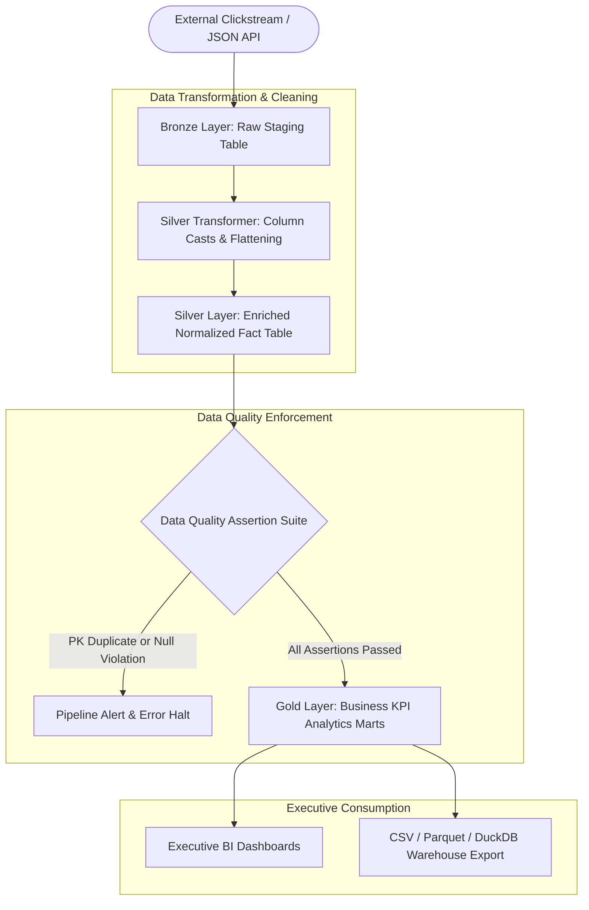

# Modern Automated ELT Data Pipeline

[](LICENSE)
[](https://python.org)
[](#)
[](#)
[](https://github.com/samaysawal24)

An enterprise-grade columnar ELT data pipeline architecture implementing the Medallion Data Design pattern (Bronze Ingestion -> Silver Cleaning & Normalization -> Gold Aggregation Marts). Features integrated automated data quality assertions (uniqueness, null checks, business logic invariants) and instant KPI reporting.

---

## 🏛️ System Architecture



---

## 🚀 Key Features

- **Medallion Architecture:** Clear separation of concerns between raw append-only Bronze staging, cleaned typed Silver facts, and aggregated Gold dimensional tables.
- **Automated Data Quality Gates:** Validates primary key uniqueness, null thresholds, and revenue domain constraints before updating Gold views.
- **Zero Heavy Infrastructure Dependency:** High-speed in-process execution with Pydantic and native Python streaming.
- **Actionable CLI Interface:** Execute batch runs or inspect data quality scorecards with simple command-line arguments.
- **Containerized Execution:** Ready for scheduled Kubernetes CronJob or Docker Compose batch runs.

---

## 📦 Project Structure

```
automated-elt-data-pipeline/
├── pipeline/
│   ├── __init__.py           # Package exports
│   ├── extract.py            # Bronze raw batch ingestion
│   ├── models.py             # Pydantic v2 schemas and test result types
│   ├── quality.py            # Data quality assertion test suite
│   ├── runner.py             # Pipeline orchestrator
│   └── transform.py          # Silver transformations and Gold rollups
├── tests/
│   └── test_pipeline.py      # Pytest unit tests
├── cli.py                    # Command-line interface
├── Dockerfile                # Production container spec
├── docker-compose.yml        # Orchestration spec
├── pyproject.toml            # Python packaging metadata
├── requirements.txt          # Frozen dependencies
├── LICENSE                   # MIT License (smay)
└── README.md
```

---

## ⚡ Quickstart

### 1. Local Setup

```bash
git clone https://github.com/samaysawal24/automated-elt-data-pipeline.git
cd automated-elt-data-pipeline

python -m venv .venv
source .venv/bin/activate  # On Windows: .venv\Scripts\activate

pip install -r requirements.txt
```

### 2. Run Pipeline

```bash
python cli.py run --batch-size 100
```

Sample Output:
```
=== ELT Pipeline Execution Summary ===
Run ID:                 run_9c82df1b
Bronze Ingested Rows:   100
Silver Cleaned Rows:    100
Latency:                0.008s
Data Quality Gate:      PASSED

=== Data Quality Assertions ===
  [PASS] assert_unique_event_id         | Found 0 duplicate primary key IDs
  [PASS] assert_not_null_user_id        | Found 0 null or empty user identifiers
  [PASS] assert_non_negative_revenue    | Found 0 records with negative currency values

=== Gold Analytics KPI Mart ===
  Total Revenue:       $1,999.60
  Total Conversions:   20
  Conversion Rate:     20.0%
  Unique Active Users: 12
  Revenue by Country:  {'US': 449.91, 'DE': 399.92, 'IN': 349.93, 'GB': 299.94, 'CA': 299.95, 'FR': 199.95}
```

---

## 🧪 Running Tests

```bash
pytest tests/ -v
```

---

## 📜 License & Author

- **Author:** smay ([@samaysawal24](https://github.com/samaysawal24))
- **Email:** cricketworldsamay@gmail.com
- **License:** Released under the [MIT License](LICENSE).
